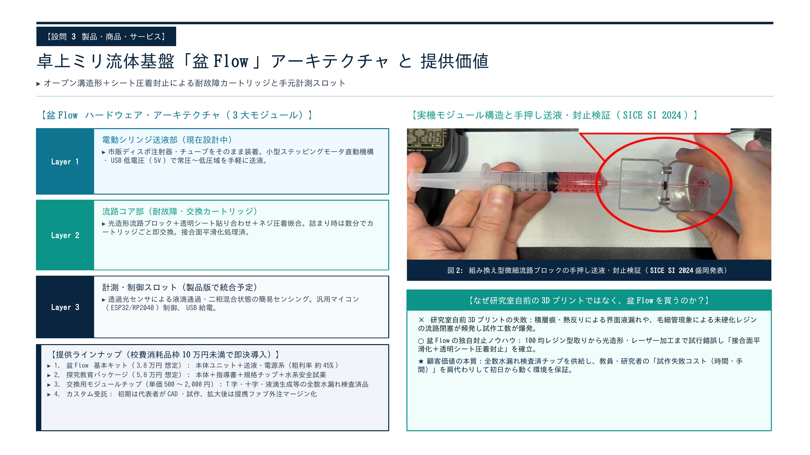
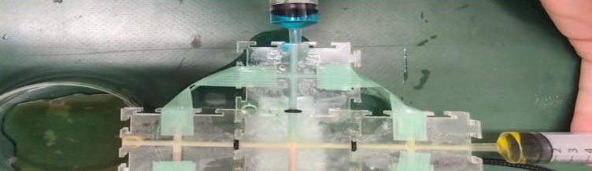
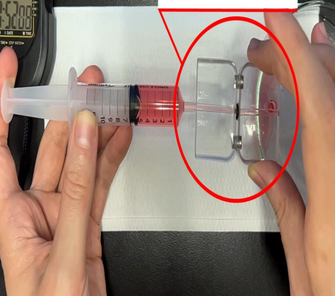

# 盆Flow (BonFlow): Desktop Modular Milli/Microfluidic Platform
**卓上モジュラー型ミリ流体実験基盤「盆Flow」**

## Overview / 概要
**BonFlow (盆Flow)** is an open-source, A5-sized desktop milli/microfluidic platform designed for hands-on fluidic engineering education and rapid cold-run physical screening (droplet generation, laminar mixing, and interfacial phenomena).

既存の連続フロー・マイクロ流体実験装置（1台数百万円〜1,000万円超）の過剰スペックを削ぎ落とし、大学・高専の学生実験および初期の物理条件出し（コールドラン）に特化したA5サイズの卓上ミリ流体プラットフォームです。

- **Low-Cost & Accessible**: Designed around off-the-shelf stepping motor syringe actuation, 5V USB power, and ESP32/RP2040 control.
- **Disposable Modular Cartridges**: Rapid cartridge replacement in minutes when clogging (流路閉塞) or bio/chemical cross-contamination (コンタミ・交差汚染) occurs.
- **Dimensionless Similarity ($Re, Ca$)**: Enables safe cold-run physical screening of laminar diffusion and emulsion/droplet formation using model fluids (water, oil, surfactants, dyes) by matching Reynolds ($Re$) and Capillary ($Ca$) numbers.

---

## Prototype Validation / 試作・学会発表実績

Supported by the **METI Tohoku "MiTOHOKU Program" (2nd Cohort)** and presented at **SICE SI 2024** (Morioka, Dec 2024).

| Two-Fluid Confluence in Modular Cross-Channel | Syringe-Driven Sealing & Leak Test |
|:---:|:---:|
|  |  |
| **図1**: 組み換え型十字流路モジュールにおける二液合流検証 | **図2**: 手押し注射器送液による接合面封止・液漏れ確認 |

---

## Architecture / システム構成

1. **Pumping Unit (送液駆動部 - α版設計中)**
   - Linear stepping motor actuator compatible with standard disposable syringes.
2. **Interchangeable Fluidic Cartridges (流路コア部)**
   - SLA 3D-printed open-groove channels sealed with transparent film via surface-smoothing and pressure-bonding process.
3. **Optical Sensing Slot (計測スロット - α版設計中)**
   - Transmissive optical sensor slot for droplet passage and mixing state detection (ESP32 / RP2040).

---

## Roadmap / 開発ロードマップ

- [x] **Step 0 (2024)**: Modular channel sealing & manual syringe confluence validation (**MiTOHOKU 2nd Cohort**, **SICE SI 2024** presentation).
- [ ] **Step 1 (2026–2027)**: Standalone automated stepping-motor syringe unit & optical sensor integration (CAD/STL, PCB Gerber, and firmware release).
- [ ] **Step 2 (2027–)**: Educational curriculum recipes (Reynolds/Capillary similarity experiments) & chemical-resistant fluoropolymer/glass-coated cartridge development.

---

## Author / 開発者
- **Yosito Ueno (上野 能登)**
  - Faculty of Engineering, Yamagata University (山形大学 工学部 システム創成工学科)
  - MiTOHOKU Program 2nd Cohort Creator (未踏東北 第2期 採択クリエータ)
