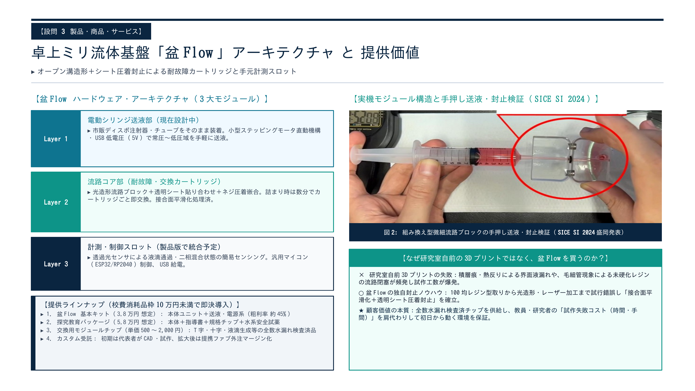
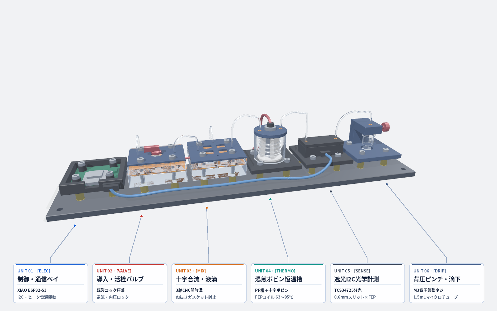
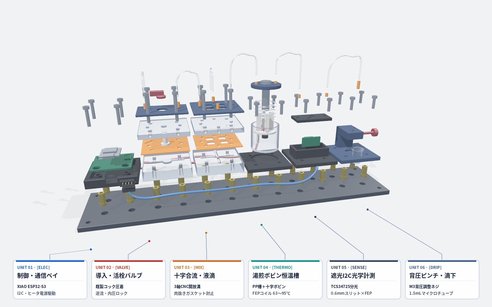
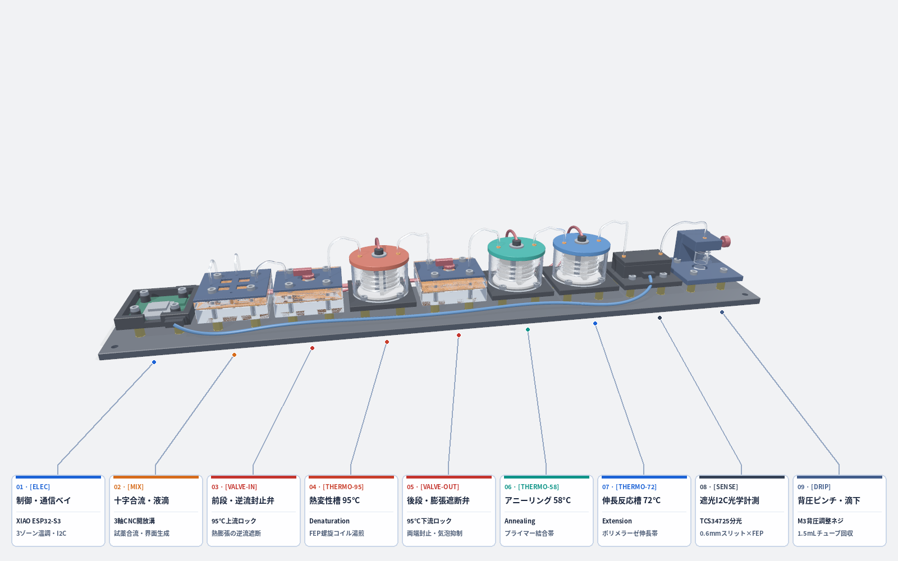
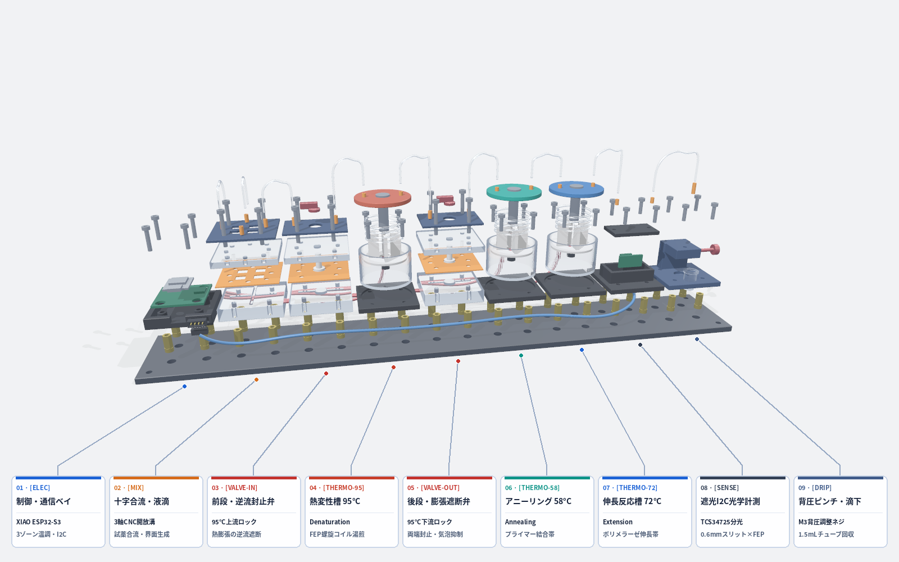
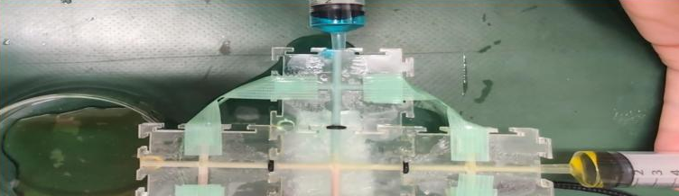
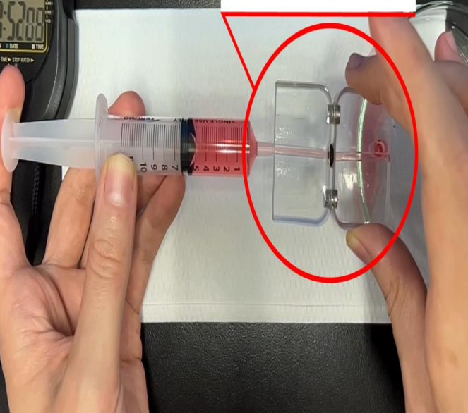

# 盆Flow (BonFlow): Desktop Modular Milli/Microfluidic Platform
**卓上モジュラー型ミリ流体実験基盤「盆Flow」**

[](LICENSE)



> **Safety & Operational Scope Disclaimer / 安全・適用範囲に関する免責**
>
> Provided **"AS IS"** under the [MIT License](LICENSE) strictly for **educational and preliminary cold-run verification** using **aqueous model fluids at ambient pressure and 5V DC USB low-voltage control**. It is NOT designed, rated, or certified for hazardous chemicals, volatile/aggressive organic solvents incompatible with PMMA/silicone, high-pressure operation, clinical/medical diagnostics, or biological containment. All custom fabrication, assembly, pressurization, and chemical handling remain solely at the user's own risk and responsibility.

---

## Overview / 概要
**BonFlow (盆Flow)** is an open-source, A5-sized desktop milli/microfluidic platform designed for hands-on fluidic engineering education and rapid cold-run physical screening (droplet generation, laminar mixing, and isothermal thermal reactions).

既存の連続フロー・マイクロ流体実験装置（1台数百万円〜1,000万円超）の過剰スペックを削ぎ落とし、大学・高専の学生実験および初期の物理条件出し（コールドラン）に特化した卓上ミリ流体プラットフォームです。

- **Low-Cost & Accessible**: Designed around 5V USB power, ESP32-S3 (Seeed XIAO) / RP2040 I2C control, and off-the-shelf disposable tubing/stopcocks.
- **Disposable Modular Cartridges (1U = 46 × 46 mm)**: Rapid cartridge replacement in minutes when clogging (流路閉塞) or cross-contamination (コンタミ・交差汚染) occurs.
- **Software-Hardware Isomorphism (`bonflow_arch.py`)**: Every 1U module inherits from the `FluidicModule` ABC—automatically binding graph reachability & pressure/backpressure auditing to 4-layer watertight B-Rep CAD generation.

---

## BonFlow-Open-v4.0 Hardware Standard

**v4.0 Architecture** eliminates fragile inter-block lateral O-ring butt joints by adopting a **25.0 mm pitch optical breadboard grid**, **1U (46 × 46 mm) 4-layer press-fit cartridges**, and **vertical Ø1.6 mm OD FEP tubing** drop-in interconnects:

- **Grid & Mounting**: 25.0 mm optical pitch with M6/Ø6.5 mm brass standoff mounting (`Z_STANDOFF_H = 10.0 mm`) isolating electronics and raising the fluidic plane.
- **1U 4-Layer Cartridge Stack**: CNC PMMA base (`10.0 mm`) + cutout silicone gasket (`0.8 mm`) + laser PMMA lid (`5.0 mm`) + acrylic tubing retainer plate (`1.7 mm`), clamped by 4 corner M3 bolts (`±12.5, ±12.5 mm`).
- **Interference-Audited Assemblies (`0.0000 mm³` collision verified)**:
  - **6U Continuous-Flow Isothermal LAMP (`cad_v4/fluidic_graph.json`, `cad_v4/bonflow_v4_assembly.step`)**: 35 parts (`elec_1u` → `valve_1u` → `mix_1u` → `thermo_1u` → `sense_1u` → `drip_1u`), 595 part pairs audited (`0` overlaps `> 0.01 mm³`).
  - **9U Dual-Valve Sealed PCR Reference (`cad_v4/fluidic_graph_pcr.json`, `cad_v4/bonflow_v4_pcr_assembly.step`)**: 53 parts with upstream/downstream stopcock confinement across 95°C / 58°C / 72°C zones (`0.0000 mm³` collision).

| 6U LAMP Assembly (v4.0) | 6U LAMP Exploded View |
|:---:|:---:|
|  |  |

| 9U PCR Reference Assembly (v4.0) | 9U PCR Exploded View |
|:---:|:---:|
|  |  |

---

## OOP Software-Hardware Isomorphism (`cad_v4/bonflow_arch.py`)

External collaborators and third-party labs can extend BonFlow-Open-v4.0 simply by subclassing `FluidicModule` in [`cad_v4/bonflow_arch.py`](cad_v4/bonflow_arch.py):

1. **Logical & Hydraulic Contract**: Define `ports()`, `internal_paths(state)`, `capabilities(state)`, and `requirements(state)`. `BonFlowRail.evaluate()` detects:
   - Dead-head pressure locks (no reachable `SINK`),
   - Missing downstream `backpressure` on heated zones (`>= 60°C`),
   - Active unplugged `OUTLET` ports (`UNPLUGGED_OUTLET_LEAK`),
   - Cross-domain I2C-to-fluidic wiring errors, duplicate/double-wired ports, and self-loops,
   - Recirculation cycles and diamond split-merge bypass paths.
2. **Mechanical Keep-Out & Parametric B-Rep CAD**: Declare `channel_segments_mm()` and `chamber_cavities_mm()`. `validate_keepout()` + `export_1u_cad()` enforce M3 corner bolt sleeve clearances (`>= 3.2 mm` wall clearance / `r=3.0 mm` B-Rep sleeve intersection audit) and floor thickness (`0 < depth <= 8.0 mm`), then compile watertight 4-layer `STEP` & `STL` assets (reference third-party example: `SwitchableTrapModule` in [`cad_v4/custom_1u_out/`](cad_v4/custom_1u_out/)).

### Quickstart / 検証・CAD生成の実行

Requires Python 3.11+ (`build123d` needed for B-Rep CAD audit/export; graph & keep-out verification runs with stdlib alone):

```bash
# Run 5 standard self-tests + 12 adversarial verification checks + 1U CAD export
python3 cad_v4/bonflow_arch.py
```

---

## Prototype Validation / 試作・学会発表実績

Supported by the **METI Tohoku "MiTOHOKU Program" (2nd Cohort)** and presented at **SICE SI 2024** (Morioka, Dec 2024).

| Two-Fluid Confluence in Modular Cross-Channel | Syringe-Driven Sealing & Leak Test |
|:---:|:---:|
|  |  |
| **図1**: 組み換え型十字流路モジュールにおける二液合流検証 | **図2**: 手押し注射器送液による接合面封止・液漏れ確認 |

---

## Repository Contents

| Path | Description |
|---|---|
| [`LICENSE`](LICENSE) | MIT License + Safety & Operational Scope Disclaimer |
| [`cad_v4/bonflow_arch.py`](cad_v4/bonflow_arch.py) | OOP `FluidicModule` ABC, `BonFlowRail` verifier, 1U B-Rep CAD compiler & test suite |
| [`cad_v4/fluidic_graph.json`](cad_v4/fluidic_graph.json) | 6U isothermal LAMP directed graph manifest |
| [`cad_v4/fluidic_graph_pcr.json`](cad_v4/fluidic_graph_pcr.json) | 9U PCR reference directed graph manifest |
| [`cad_v4/bonflow_v4_cad.py`](cad_v4/bonflow_v4_cad.py) | 6U full assembly B-Rep generator & collision auditor |
| [`cad_v4/bonflow_v4_pcr_cad.py`](cad_v4/bonflow_v4_pcr_cad.py) | 9U PCR reference assembly B-Rep generator |
| [`cad_v4/bonflow_v4_assembly.step`](cad_v4/bonflow_v4_assembly.step) | 6U full assembly STEP CAD |
| [`cad_v4/bonflow_v4_pcr_assembly.step`](cad_v4/bonflow_v4_pcr_assembly.step) | 9U PCR assembly STEP CAD |
| [`cad_v4/custom_1u_out/`](cad_v4/custom_1u_out/) | `SwitchableTrapModule` auto-generated 1U STEP/STL layers |

---

## Roadmap / 開発ロードマップ

- [x] **Step 0 (2024)**: Modular channel sealing & manual syringe confluence validation (**MiTOHOKU 2nd Cohort**, **SICE SI 2024** presentation).
- [x] **Step 1a (2026)**: **BonFlow-Open-v4.0** 25mm grid hardware standard, 6U/9U collision-free STEP CAD, OOP `FluidicModule` specification & adversarial topology/keep-out verifier.
- [ ] **Step 1b (2026–2027)**: Standalone automated stepping-motor syringe unit & optical sensor integration (PCB Gerber and firmware release).
- [ ] **Step 2 (2027–)**: Educational curriculum recipes (Reynolds/Capillary similarity experiments) & chemical-resistant fluoropolymer/glass-coated cartridge development.

---

## Author / 開発者
- **Yosito Ueno (上野 能登)**
  - Faculty of Engineering, Yamagata University (山形大学 工学部 システム創成工学科)
  - MiTOHOKU Program 2nd Cohort Creator (未踏東北 第2期 採択クリエータ)
